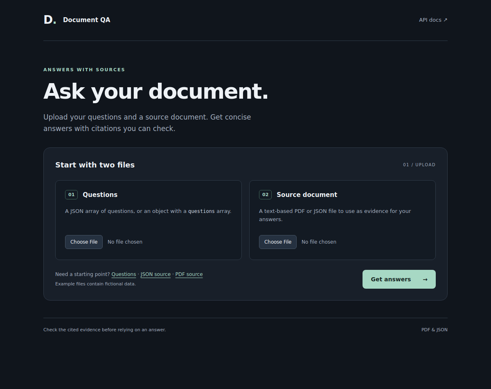
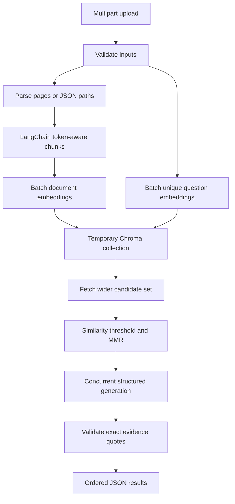

# Document QA

A FastAPI service that answers a batch of questions from one uploaded PDF or JSON
document. Answers include source citations. Insufficient evidence returns exactly
`not found`. A dark-mode interface is available at `/`.



## Quick start

Requires Docker with Compose. From the project directory:

```bash
cp .env.example .env
# Set OPENAI_API_KEY in .env for live answers.
docker compose up --build
```

On Windows PowerShell, copy the environment file with `Copy-Item .env.example .env`.

- Open the [upload interface](http://localhost:8000) or the [API docs](http://localhost:8000/docs).
- Without an API key, valid QA requests return `503 PROVIDER_NOT_CONFIGURED`. The key stays on the server.
- The interface includes fictional samples, loading and error states, per-question status, expandable evidence, and a JSON download. All uploaded and generated text is shown as plain text.
- The container runs as a non-root user with a read-only filesystem, `no-new-privileges`, a 2 GiB memory limit, and a loopback-only port.
- The image has a `/health` healthcheck, pinned dependencies, and a build context that excludes `.env`, tests, and local caches.
- Uvicorn accepts 16 concurrent connections. Generation is limited to 4 calls per process. No database or volume is required.

## API

`POST /api/v1/qa` accepts exactly two multipart files:

| Field | Format |
| --- | --- |
| `questions_file` | JSON string array, or an object containing only a `questions` array |
| `document_file` | Text-based PDF or JSON object/array |

```bash
curl -X POST http://localhost:8000/api/v1/qa \
  -F "questions_file=@app/static/examples/questions.json;type=application/json" \
  -F "document_file=@app/static/examples/document.json;type=application/json"
```

On Windows, use `curl.exe` if `curl` is a PowerShell alias. For a PDF, substitute `app/static/examples/document.pdf` and `application/pdf`.

```json
{
  "request_id": "00000000-0000-0000-0000-000000000000",
  "results": [{
    "question": "Which cloud provider is used?",
    "status": "answered",
    "answer": "AWS",
    "citations": [{"source_type": "pdf", "page": 1, "snippet": "Production uses AWS."}]
  }],
  "metadata": {
    "questions_received": 1, "questions_answered": 1,
    "questions_not_found": 0, "questions_failed": 0,
    "chunk_count": 2, "latency_ms": 2500
  }
}
```

| Status | Answer | Citations |
| --- | --- | --- |
| `answered` | Nonblank answer text | Page or JSON path, plus a focused verbatim quote |
| `not_found` | Exactly `not found`, with an optional one-sentence `explanation` | Empty |
| `error` | `null`, with an `error` object | Empty |

- A `not_found` explanation says what the retrieved passages cover and what is missing, for example: "Incident reporting timelines are mentioned, but client notification criteria and SLAs are not provided."
- `answer` stays exactly `not found` so clients can match it. The interface shows the answer and explanation together.
- Question order and duplicates are preserved. Duplicate questions share provider work.
- A generation failure affects only that question. HTTP 200 can contain partial or entirely failed results.
- Embedding failures return 502 or 504 for the whole request. Validation uses 413, 415, or 422. A processing deadline returns 504.
- Request errors use `{"error":{"code":"...","message":"...","request_id":"..."}}`.
- `GET /health` returns `{"status":"ok"}` and checks liveness, not provider readiness.
- A valid UUID `X-Request-ID` is reused. A missing or invalid value is replaced.

## Architecture



- **Chunking:** each page or JSON value becomes a LangChain document. `RecursiveCharacterTextSplitter` splits it on paragraph, line, and word boundaries with the bundled tokenizer. Chunks stay inside one page or JSON value.
- **Providers:** embeddings use `text-embedding-3-small`. Answers use `gpt-4o-mini`. Calls are async, batched, and made without SDK retries.
- **Retrieval:** each request builds a temporary Chroma collection, fetches a wider candidate set, drops weak cosine matches, and reranks the rest with maximal marginal relevance. The collection is deleted when the search finishes.
- **Grounding:** the model returns answerability, answer text, and exact quotes. Only a quote found verbatim in a retrieved chunk becomes a citation. Unsupported questions return `not found`.
- **Bounds:** uploads, chunks, and provider batches are size-limited. Generation shares a process-wide concurrency limit, and each request has a deadline. Parsing and indexing run in worker threads.

Chroma is pinned to 1.0.20 because 1.5.9 failed to load its native library here. Tokenizer attribution is in [THIRD_PARTY_NOTICES.md](THIRD_PARTY_NOTICES.md).

## Configuration and limits

Environment variables override `.env`. See `.env.example`.

| Setting | Default |
| --- | ---: |
| Document / questions upload | 20 MiB / 1 MiB |
| Multipart overhead allowance | 64 KiB |
| Questions / question length | 25 / 2,000 characters |
| PDF pages / extracted characters | 200 / 1,000,000 |
| JSON depth / records / chunks | 64 / 10,000 / 10,000 |
| Chunk size / overlap | 800 / up to 120 tokens |
| Retrieval candidates / final chunks | 20 / 5 |
| Minimum cosine similarity / MMR lambda | 0.15 / 0.7 |
| Embedding batch items / tokens | 64 / 16,000 |
| Concurrent generations per process | 4 |
| Provider timeout / processing deadline | 30s / 180s |

- Upload size is checked before multipart parsing, independently of `Content-Length`.
- The processing deadline starts after the upload has been received.

## Tests

```bash
pytest -q
ruff check .
node --check app/static/app.js
```

- Tests run offline and need no API key. They cover PDF and JSON parsing, tokenization, Chroma retrieval, mocked provider calls, concurrency, cancellation, deadlines, log privacy, and the full endpoint.
- With the service running, score the grounding corpus:

```bash
python -m evals.runner --base-url http://127.0.0.1:8000
```

- The corpus, settings, and results are in [grounding evaluation](docs/grounding-evaluation.md).
- `requirements.lock` pins the runtime versions used by the image.

## Observability and limitations

- JSON logs include the request ID, stage timings, result counts, provider call counts, and provider-reported token usage.
- `usage_missing_calls` counts calls that returned no usage.
- Logs omit filenames, questions, document text, answers, prompts, and API keys.
- A citation proves its snippet occurs in a retrieved chunk. It does not prove every answer claim follows from that snippet.
- Retrieval can miss relevant text, and text inside a document is not a complete defense against prompt injection.
- Scanned PDFs have no text layer and are rejected.
- The service has no authentication and is meant for local use.
